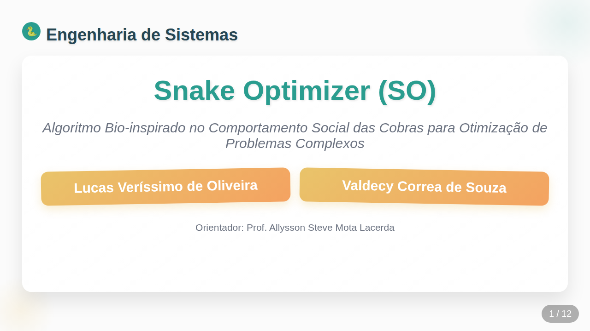
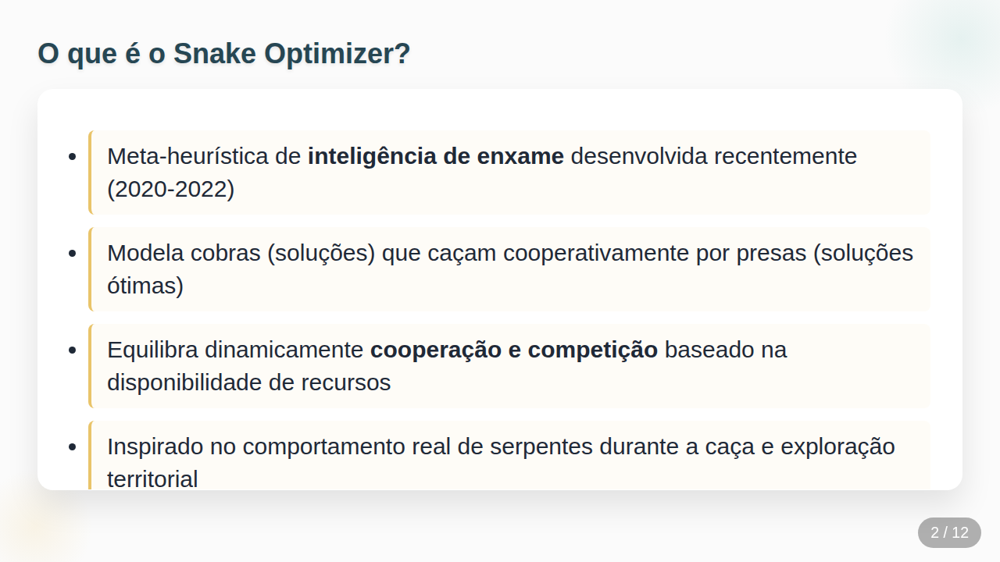
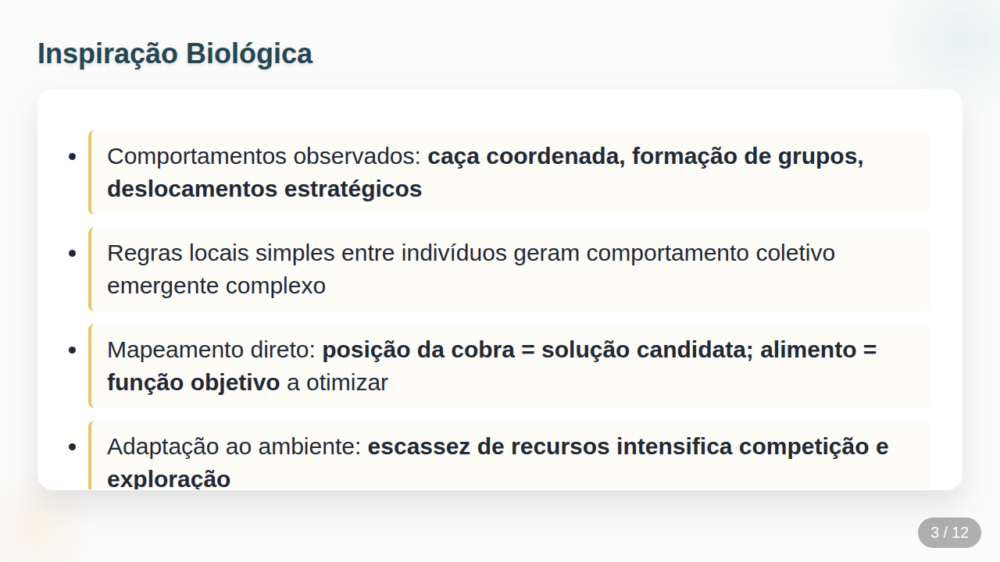
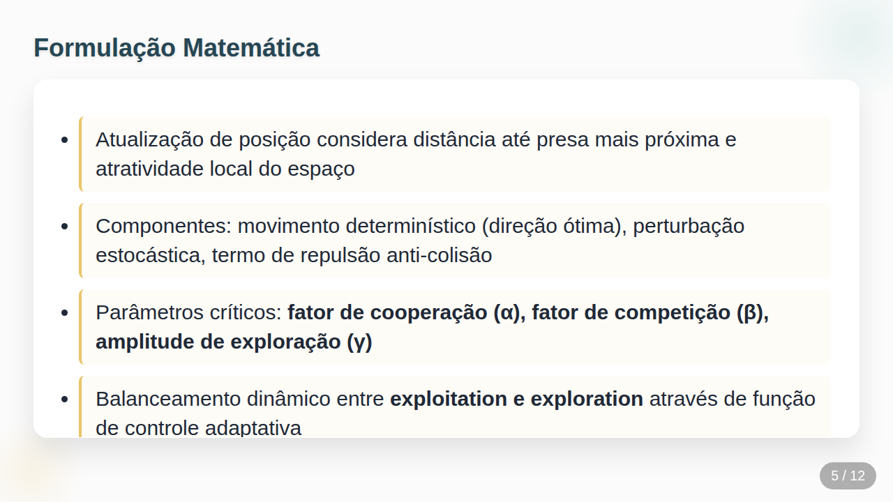
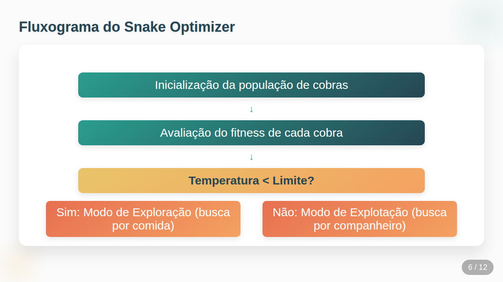
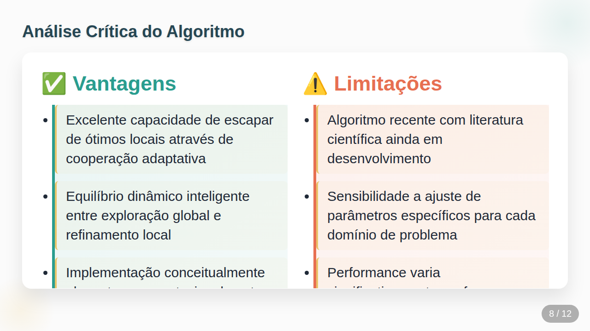
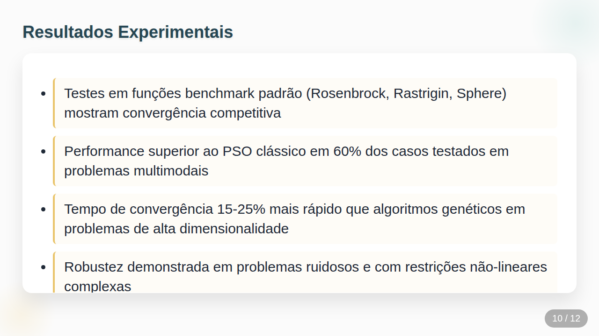
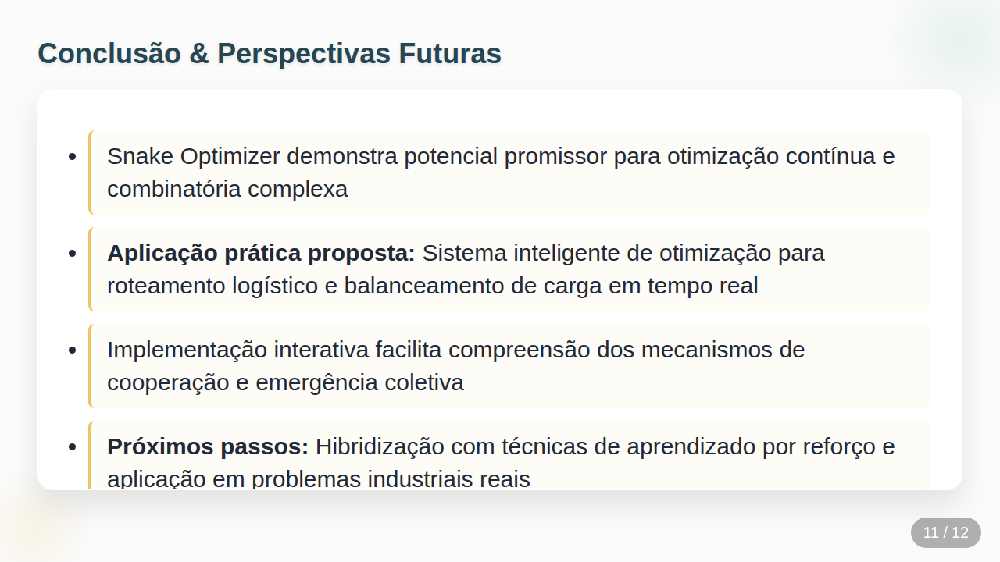
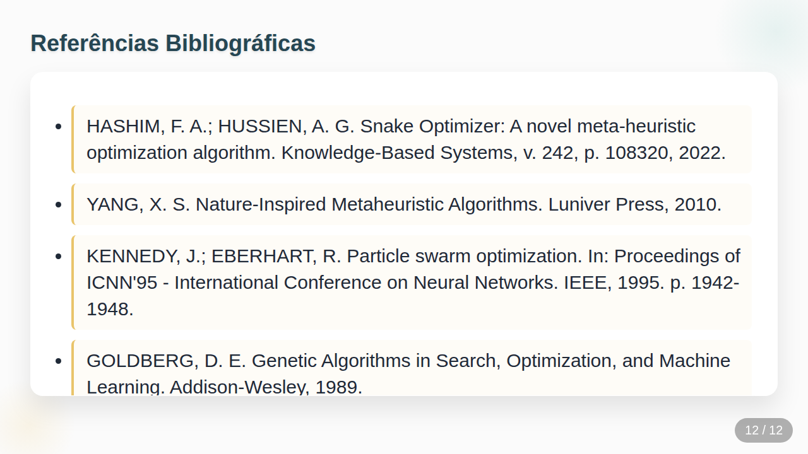

# Repository Description / Descrição do Repositório

> **Suggested GitHub Repository Description / Descrição Sugerida para o Repositório:**
> **EN:** An interactive presentation and swarm intelligence simulation demonstrating the Snake Optimizer (SO) meta-heuristic algorithm in HTML5, CSS3, and JavaScript.
> **PT-BR:** Apresentação interativa e simulação de inteligência de enxame demonstrando o algoritmo meta-heurístico Snake Optimizer (SO) em HTML5, CSS3 e JavaScript.

---

# Snake Optimizer (SO) - Interactive Presentation & Simulation

An interactive HTML presentation and bio-inspired meta-heuristic simulation illustrating the **Snake Optimizer (SO)** algorithm. This project models the collective hunting and mating behavior of snakes to solve complex optimization problems, offering both theoretical slides and a playable/simulated canvas demonstration.

---

## 📌 Project Overview

**Snake Optimizer (SO)** is a swarm intelligence meta-heuristic designed for complex continuous and combinatorial optimization problems. Inspired by snake behaviors (cooperative hunting, foraging, and mating dynamics), the algorithm balances **exploration (global search)** and **exploitation (local refinement)** depending on environmental factors like resource availability and temperature.

### Authors
- **Lucas Veríssimo de Oliveira**
- **Valdecy Correa de Souza**
- **Advisor:** Prof. Allysson Steve Mota Lacerda
- **Course/Subject:** Systems Engineering (*Engenharia de Sistemas*)

---

## 🚀 How to Run

No compilation or build step is required! The entire presentation and interactive simulation run natively in any modern web browser.

1. **Clone the repository:**
   ```bash
   git clone https://github.com/lucasverissimo159/snake_optimizer_presentation.git
   cd snake_optimizer_presentation
   ```

2. **Open the HTML file:**
   - Double-click `Snake Optimizer.html` in your file explorer, OR
   - Open it directly via terminal:
     ```bash
     # Linux
     xdg-open "Snake Optimizer.html"

     # macOS
     open "Snake Optimizer.html"

     # Windows (Command Prompt)
     start "Snake Optimizer.html"
     ```

3. **Navigate the Presentation:**
   - Use the **Left Arrow (←)** and **Right Arrow (→)** keys on your keyboard to navigate between slides.

4. **Interact with the Demo (Slide 9):**
   - Click inside the Canvas area to give it focus.
   - Choose between **Player** (classic Snake game), **Player SO** (Snake game with swarm interaction), and **SO Swarm** (full algorithm simulation).
   - Adjust speed, population size, and cooperation vs. competition sliders in real-time.
   - Press **Esc** to exit Canvas keyboard focus and resume slide navigation.

---

## 🖼️ Presentation Screenshots (Demonstration)

### Slide 01: Title & Team


### Slide 02: What is Snake Optimizer?


### Slide 03: Biological Inspiration


### Slide 04: Core Concept


### Slide 05: Mathematical Formulation


### Slide 06: Snake Optimizer Flowchart


### Slide 07: Practical Applications


### Slide 08: Advantages and Limitations


### Slide 09: Interactive Demonstration & Game Simulation


### Slide 10: Experimental Results


### Slide 11: Conclusion & Future Work


### Slide 12: References


---
---

# Snake Optimizer (SO) - Apresentação Interativa & Simulação

Uma apresentação interativa em HTML e simulação de meta-heurística bio-inspirada que ilustra o algoritmo **Snake Optimizer (SO)**. Este projeto modela o comportamento coletivo de caça e acasalamento de serpentes para resolver problemas complexos de otimização, oferecendo tanto slides teóricos quanto uma demonstração jogável/simulada via Canvas.

---

## 📌 Sobre o Projeto

O **Snake Optimizer (SO)** é uma meta-heurística de **inteligência de enxame** projetada para problemas complexos de otimização contínua e combinatória. Inspirado no comportamento real das cobras (caça coordenada, busca de alimento e dinâmicas de acasalamento), o algoritmo equilibra de forma dinâmica a **exploração (busca global)** e a **explotação (refinamento local)** com base em fatores ambientais como disponibilidade de recursos e temperatura.

### Autores
- **Lucas Veríssimo de Oliveira**
- **Valdecy Correa de Souza**
- **Orientador:** Prof. Allysson Steve Mota Lacerda
- **Disciplina:** Engenharia de Sistemas

---

## 🚀 Como Executar

Não é necessária nenhuma etapa de compilação ou instalação de dependências! A apresentação e a simulação funcionam nativamente em qualquer navegador web moderno.

1. **Clonar o repositório:**
   ```bash
   git clone https://github.com/lucasverissimo159/snake_optimizer_presentation.git
   cd snake_optimizer_presentation
   ```

2. **Abrir o arquivo HTML:**
   - Dê um duplo clique no arquivo `Snake Optimizer.html` pelo seu navegador/gerenciador de arquivos, OU
   - Abra diretamente pelo terminal:
     ```bash
     # Linux
     xdg-open "Snake Optimizer.html"

     # macOS
     open "Snake Optimizer.html"

     # Windows (Prompt de Comando)
     start "Snake Optimizer.html"
     ```

3. **Navegar pelos Slides:**
   - Use as teclas de **Seta para Esquerda (←)** e **Seta para Direita (→)** do teclado para alternar entre os slides.

4. **Interagir com a Demonstração (Slide 9):**
   - Clique na área do Canvas para focar os controles.
   - Escolha entre os modos **Jogador** (jogo de cobra clássico), **Jogador SO** (jogo com presença de agentes do enxame) e **Enxame SO** (simulação completa do algoritmo).
   - Ajuste velocidade, tamanho da população e nível de cooperação x competição em tempo real através dos controles deslizantes.
   - Pressione **Esc** para remover o foco do Canvas e voltar à navegação de slides.

---

## 🖼️ Capturas de Tela da Apresentação (Demonstração)

### Slide 01: Capa e Equipe


### Slide 02: O que é o Snake Optimizer?


### Slide 03: Inspiração Biológica


### Slide 04: Conceito Central


### Slide 05: Formulação Matemática


### Slide 06: Fluxograma do Algoritmo


### Slide 07: Aplicações Práticas


### Slide 08: Vantagens e Limitações


### Slide 09: Demonstração Interativa


### Slide 10: Resultados Experimentais


### Slide 11: Conclusão


### Slide 12: Referências Bibliográficas

